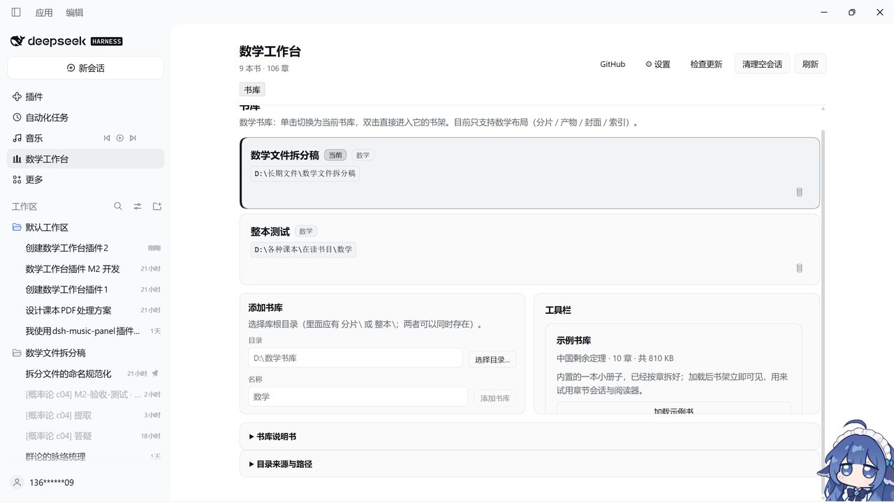
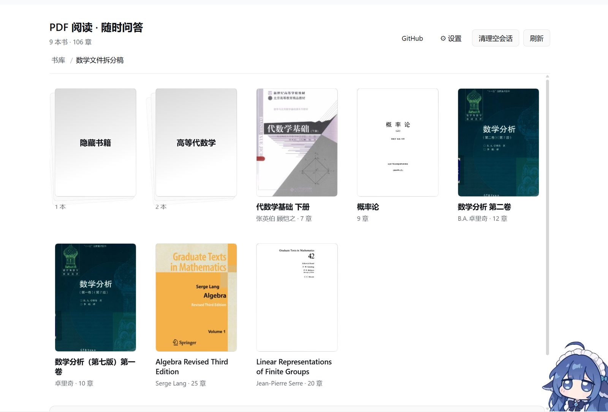
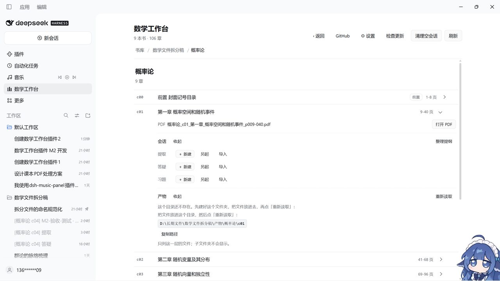
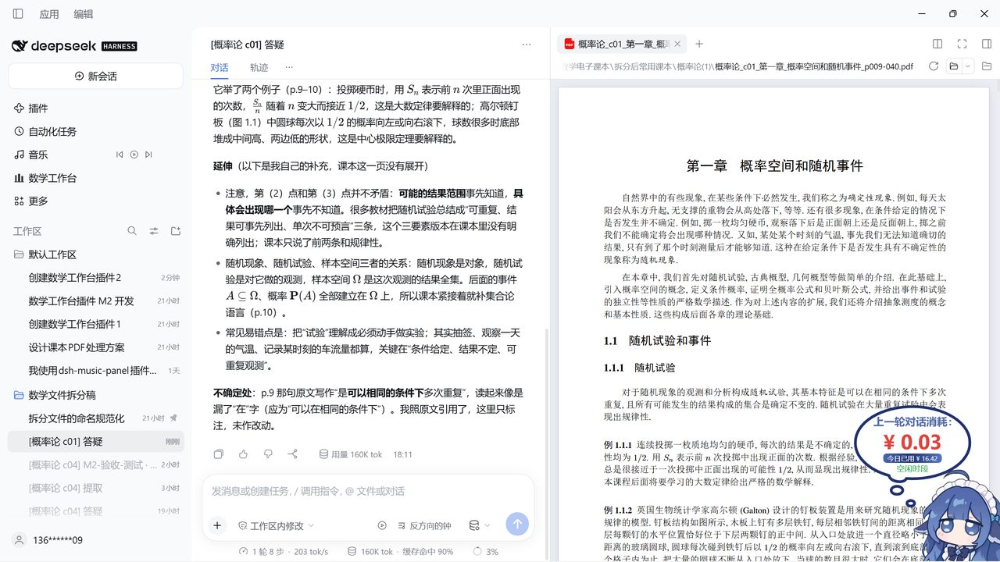

# 数学工作台 · dsh-pdf-math-desk

[](https://www.npmjs.com/package/dsh-pdf-math-desk)
[](https://github.com/topics/dsh-plugin)
[](./LICENSE)

> 面向数学书阅读的 DSH 插件：以「书 → 章」为骨架，把 **PDF 阅读、章节会话、产物管理** 放进同一个整页工作台。

<p align="center">
  
</p>

## 为什么

读数学书是学数学最好的方式之一，但“摘抄—提问—对答案—做笔记”这条链路很费时间。这个插件把它收进一个界面：

- **提取**：公式转成 `$...$` / `$$...$$`，直接贴进 Obsidian；
- **答疑**：会话自带书名、章名、PDF 与页码，跟着你读到的位置问；
- **习题**：做本章习题、对答案；
- 产物（md / 渲染 PDF）留在章节目录里，随读随查。

## 功能一览

| 模块 | 能力 |
| --- | --- |
| 书库 | 多书库、单击切换、🗑 移除（确认）；分片 / 整本两种模式 |
| 书架 | 单击选中、双击进章节、拖拽框选；隐藏书籍、自定义书架（可嵌套）、删除释放 |
| 章节 | 会话（提取/答疑/习题）、导入已有会话、重命名、整理提纲 |
| 产物 | 行内预览、md → PDF、产物会话、按需折叠、移入回收站 |
| 阅读器 | pdf.js，单页/连续、翻页、页码、缩放、键盘操作、右栏预览开关 |
| 设置 | ⚙ 菜单：版本号、右侧预览、非 PDF 删除保护、GitHub 入口 |
| 清理 | 会话归档；产物删除进 `<库根>\回收站\`，可恢复 |

## 效果演示

按实际使用顺序走一遍：**选书库 → 进书架 → 展开章节 → 开会话**。

### 1. 书库页：添加并选择书库


左侧「添加书库」填库根目录；右侧「工具栏」放示例书库、拆分工具、导入文件。上方列表显示每个书库的真实路径，单击切换、双击进入书架。

### 2. 书架：书、隐藏书籍与自定义书架


书卡显示封面、书名、章数；「隐藏书籍」与其他多文件书架平铺在同一网格里。单击选中、双击进章节、空白处拖拽框选。

### 3. 章节：PDF、会话与产物


展开一章后：上方是本章 PDF 与「打开 PDF」；「会话」按提取/答疑/习题分组，可新建/另起/导入；「产物」列出 md 与渲染出的 PDF，可预览、转 PDF、删除到回收站。

### 4. 会话：带着章节上下文提问，token 可见


新建的会话草稿只带一行上下文（书名 · 章名 · PDF · 阅读位置），右侧显示本章 PDF 供对照；每轮对话的 token 用量在底部可见——插件不会自动把整本 PDF 塞进上下文。

> 截图里的路径是本机示例；你添加书库后会显示自己的路径。

## 归档与删除

- 「会话」行右侧的 **归档** 按钮只是把会话**移出工作台列表**，并**不是删除**；
- 已归档会话仍保存在 DSH 中，可在 DSH 的归档里恢复或自行清理；
- 工作台不会主动删除会话；「清理空会话」只处理没发过消息的空白会话；
- 产物删除进 `<库根>\回收站\`，可恢复。

## Token 消耗（重要）

这个插件**不会**把 PDF 自动塞进模型上下文；但会话仍然按对话长度计费。具体：

| 操作 | 是否消耗 token | 说明 |
| --- | --- | --- |
| 打开书架 / 展开章节 / 预览产物 | 否 | 纯本地读取与渲染 |
| 新建会话（草稿） | 极少 | 只有一行上下文：书名 · 章名 · PDF 文件名 · 产物目录 |
| 会话里的问答 | 是 | 随对话增长；续聊会带上「整理提纲」 |
| 右侧 PDF 预览 | 否 | 只是显示，不进入模型上下文 |
| AI 主动读 PDF/文件 | 是 | 由它自己决定读取哪些页；整章 PDF 可能很大 |
| 整本 PDF 会话 | **很贵** | 没有分章，一次可能几十万 token；只建议小文件/小论文 |
| 「整理提纲」 | 是 | 把该章多个会话正文再汇总一次 |

省钱建议：
- 按章拆书，一章一个 PDF；
- 别开「整本」会话；
- 需要笔记时用「提取」而不是让 AI 通读全文；
- 产物会话默认不附 PDF，只给路径。

## 不能做什么

- **不做标注/笔记**：阅读器只读，不能高亮、批注、写回 PDF；
- **不做 OCR/整本拆分**：只按你的分片文件显示，整本只作为一本书；
- **不是通用阅读器**：章节、提取/答疑/习题这套语义面向数学书；
- **不托管书籍**：书库在你本机，跨机器需重新添加；
- **不做语义搜索**：没有对全书建索引。

## 系统要求

- **Windows 10 / 11（x64）**：目前只在这两个系统上验证过；
- DSH（桌面版或 Web 版）；
- 可选：Python 3 + TeX Live（含 xelatex、ctex），只影响「md→PDF」，不装也能读书、开会话、预览 md。

> **平台说明**：macOS / Linux **未适配、未测试**。插件里的路径拼接、`py`/`python` 启动器、TeX 检测目录都按 Windows 编写；在其他系统上大概率无法正常工作，不要安装。后续要支持会单独发布。

## 安装

### DSH 插件市场 / Discover
搜索 `dsh-pdf-math-desk` 安装（收录后）。

### npm

```bash
dsh plugin add dsh-pdf-math-desk@0.35.3
```

### 本地目录
DSH → Plugins → Add plugin → 选择本目录。


> 可选依赖：Markdown → PDF 需要本机 **Python 3 + TeX（xelatex、ctex）**。插件启动时会检测；**没检测到就不显示「转 PDF」按钮**，读书、会话、预览 md 均不受影响。安装可在书库页说明书里点「下载 TeX Live（约 5 GB）」，装好后把 TeX 的 in 加入 PATH 并重启 DSH。

## 开始使用

1. 打开左侧栏的工作台图标；
2. 书库页「添加书库」，选择库根（内含 `分片\` 或 `整本\`）；
3. 进入书架 → 双击一本书 → 展开章节 → 打开 PDF 或新建会话。

### 拆分与命名

- 一章一个 PDF，**保留目录**；文件名带页码范围或 `cNN` 即可，工作台自动编号；
- **书 id = 书目名 / 分片名前缀，添加后不要重命名该目录**（旧会话和产物靠它关联）；
- 不想拆：整本 PDF 放 `<库根>\整本\`，会作为一整本书（只有一章）。

### 给 AI 的提示词

> 给我一份报告，用 markdown 格式，数学公式行内用 $ 格式，行间用 $$ 格式，不要出现 \[ 和 \( 格式

生成的 md 放进当前章的 `产物` 目录，即可预览、转 PDF。

## 配置

- `libraries`：库目录（默认 `~\数学书库`）；
- `resumeRatio`：上下文占用达到多少时续开会话（默认 0.85）；
- `updateProxy`：检查更新所用代理（可选）。

运行时数据在 `~/.dsh/mathdesk/`：`libraries.json`、`state.json`、`links.json`、`pending.json`、`pressure.json`、`shelves.json`。

## 隐私

- 无遥测，不收集数据；
- 唯一外部请求：点击「检查更新」时访问 GitHub Releases；
- 书库只读；删除只移动到 `<库根>\回收站\`。

## 限制

- 面向数学书工作流；阅读器只读，无标注/笔记；
- Markdown→PDF 需本机 Python + TeX Live（xelatex），插件运行时不依赖；
- 书 id 由目录/文件名推导，改名会使旧会话/产物失联；
- 界面显示本机真实路径，跨机器需重新添加书库；
- 客户端改动需重启 DSH 生效。

## 开发

干净环境验收步骤见 [docs/TESTING.md](./docs/TESTING.md)（VirtualBox + Win10 测试清单）。

```bash
node --check client.js
node --check index.js
node --check src/host/routes.js
```

目录：`index.js` + `src/host/*`（Host，仅 Node 内置模块）、`client.js`（浏览器）、`tools/`（拆分工具、`md2tex.py`）、`samples/`（示例书）。

## 作者想说

详见 [docs/DETAIL.md](./docs/DETAIL.md) 底部。一句话：这是为**自己学习数学的工作流**做的插件——让 AI 参与答疑、标答与笔记，把摘抄交给工具；它不是必须的，只是一条被走过、现在整理成插件的工作流。

## 许可

[MIT](./LICENSE)
