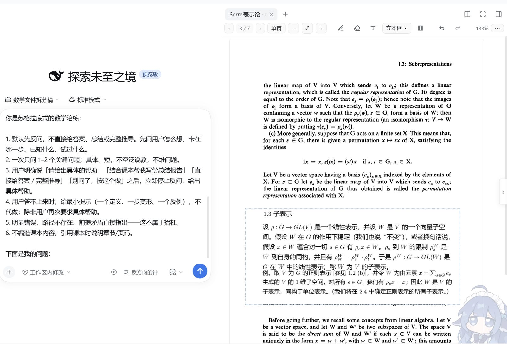
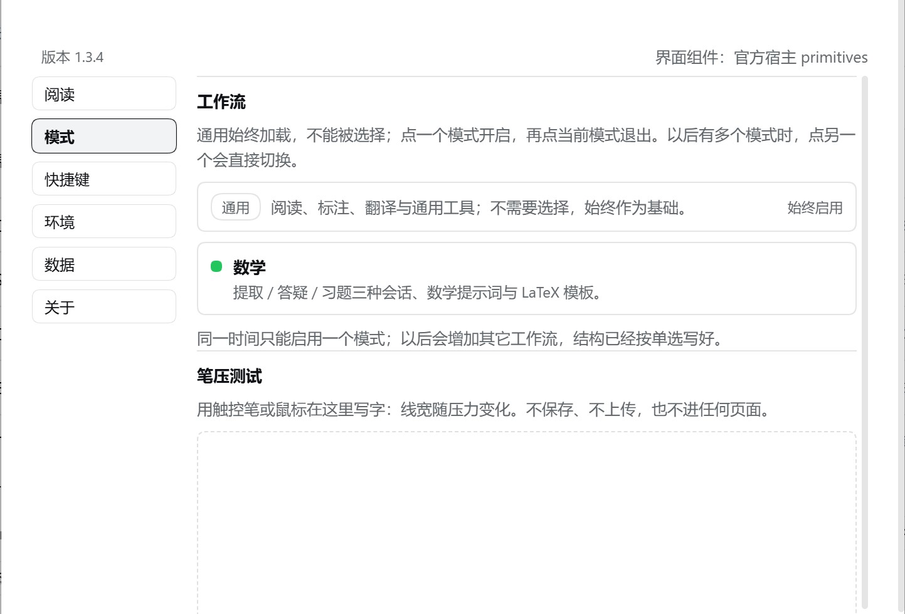
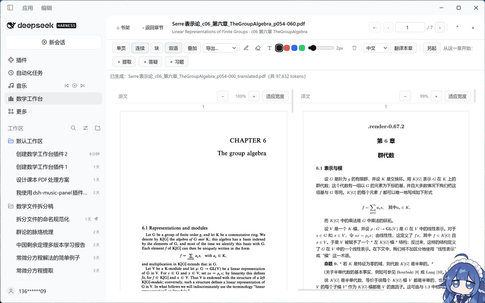

# PDF 阅读 · 随时问答

> DSH 插件：把一本 PDF 变成按章阅读、可批注、可提问的整页工作台。

[](https://www.npmjs.com/package/dsh-pdf-workbench)
[](https://github.com/minggemofashi/dsh-pdf-workbench/releases)
[](./LICENSE)
[](#已知限制)
[](https://github.com/topics/dsh-plugin)

<p align="center"></p>

读一章书，你通常要同时开阅读器、笔记和聊天窗口：这一章读到哪了？上次的批注还在吗？想问一句，还得把书名、章名、页码复制一遍。这个插件把“书 → 章”做成骨架，阅读、标注、双语、提问和产物都在同一页，会话自带书名、章名、页码和产物目录。

## 安装

在 DSH 里装插件，然后重启（客户端不热更新）：

```bash
dsh plugin add dsh-pdf-workbench
```

也可以在 **Plugins → Add plugin** 里选市场条目或解压后的目录。装完打开侧栏「PDF 阅读」：

1. **添加书库**：选一个库根目录，里面至少有 `分片` 或 `整本` 之一。
2. **载入示例书**：没有书时点这个，会装一本 10 章的《中国剩余定理》，用来熟悉书架、阅读器和拆分面板。
3. 双击书 → 展开章节 → 打开 PDF，或新建「提取 / 答疑 / 习题」会话。

书库目录长这样：

```
<库根>/
  分片/<书 id>/         一章一个 PDF，文件名带页码范围
  整本/                 整本书 PDF，作为“只有一章的一本书”
  产物/<书 id>/<章号>/  该章生成的笔记与文档
  封面/                 自定义封面
  索引.json             书名/章名等元数据（可选，插件会维护）
  .pdfdesk/             标注、疑问、附件清单、译文缓存（插件写，别手改）
```

`分片`、`整本` 放 PDF；其余目录是插件数据，改名会破坏书库与索引。

## 为什么按章

一章一个会话，只读这一章：上下文小、花费低、定位准。同一章的「提取 / 答疑 / 习题」共享一段只读一次的前缀，各自分支，互不污染。基础会话不会出现在侧栏。

不主动新建会话时，书库、书架、阅读、标注和预览都不进上下文。

## 书架与拆分

<p align="center"></p>

- **书库与书架**：多个书库；自定义书架、隐藏书籍、回收站；选中后可「加入书架」，书架内也能直接添加 PDF。
- **整本按本固定**：某本整本 PDF 想一直显示，就「一直显示整本」，按书记忆；全局「整本书」开关只影响没固定的。
- **按页拆分**：缩略图每行 4 页，页间竖向虚线 + 剪刀，范围与文件名实时预览；拆点按书记住，误关能恢复。
- **拆分更快**：缩略图由 Host 一次渲染并缓存（PyMuPDF + Pillow），80 MB 的书也能很快打开，滚到哪加载到哪；没装 Python 时回退浏览器端 pdf.js。
- **拆完的两个选择**：是否移除整本形式的书、是否打开拆分会话；只移动原 PDF，不误删同名分片目录。拆出的书自动进入整本原来所在的书架，也进入发起拆分时所在的书架。

## 阅读与画布

<p align="center"></p>

- **单页 / 连续**：单页专注一页，连续沿章节滚动，模式全局记忆；拖滚动条到底也不会空白，列会按视口重新挂载。
- **共享画布**：两种模式共用同一层注释，页外坐标可越出页面；页外只画笔记，不渲染相邻页。
- **工具**：手、选择、笔、橡皮、文本、疑问、直线、箭头、矩形、菱形、椭圆、框选；工具条竖排在页面边缘。
- **框的手感**：框用页内固定色 + 白描边，深色主题下也不消失；可在已有框上直接拖出新框；选中文本框后顶部有四向握把，四角可缩放。
- **快捷键**：`←/→` 翻页，`Ctrl +=/-` 缩放，`F` 适应宽度，`T` 切换单页/连续，`G` 跳页，`P/E/X` 笔/橡皮/文本，`Q` 疑问框，`Shift+Q` 疑问跳转，`Esc` 退出；设置 → 快捷键可改。

## 章节会话与疑问

<p align="center"></p>

- **会话自带上下文**：书名、章名、PDF、阅读位置、产物目录，不用重复解释“我在读哪本”。
- **两种思考模式**：日常（先给结论、3–5 句）与高质（允许长篇推导），都读整章；切换只影响新会话。两段风格要求可以自己改，也能一键恢复默认。
- **疑问框截图给 AI**：右侧预览框出的疑问，会把框内页面渲染成无损 WebP 一起给模型，模型能直接看清框里那块内容，而不只是页码。
- **疑问跳转**：从章节疑问列表直接跳到对应页面与框。

<p align="center"></p>

## 双语与覆盖层

<p align="center"></p>

- 整章翻译后左右并排，两栏共享页码，各有自己的标注层；翻译按页缓存，支持断点续译。
- 覆盖层在原文页上框选区显示译文：按 `layout.json` 排版的浏览器文本层 + KaTeX 公式，缩放清晰、框与字同源。
- 排版走 Typst，同一章约 10 s；没有 Typst 时回退 TeX Live 的 xelatex，装了 Typst 就不需要 TeX。

<p align="center"></p>

## 附件与产物

- **附件**：章节详情里添加 PDF / 图片，点击在阅读器中打开；重名、删除、目录内手工文件都有处理。
- **PPT → PDF**：优先本机 PowerPoint，失败再试 LibreOffice；没有转换器时明确提示，不卡住。
- **产物**：`产物/<书 id>/<章号>/` 下的文本类文件可在右侧预览，Markdown 可一键生成打印页。
- **Office 文件**：DOCX/DOC 交给 DSH 的文档预览打开，不在插件内硬渲染。

## 导入、导出与迁移

- **一个导入管线**：书库「导入文件」、封面「+」、书籍包、迁移包都走同一条 Host 管线——校验文件头（假 PDF、改名快捷方式、0 字节、非 UTF-8 文本都拒）、流式写临时文件后原子落盘、同内容（size + sha256）判重、重名统一 `-2, -3…`，一次返回统一报告。
- **导入向导**：PDF 包（子目录=拆分书，散装 PDF=整本书）+ 可选笔记包，逐本勾选；书库已有相同 PDF 的书自动勾选并置灰，PDF 不重复导入，笔记按每本选合并 / 覆盖 / 跳过。
- **导入后是否拆分**可以记住：记住后不再每次弹窗，设置 → 阅读里能改回每次询问。
- **三种包**：整机迁移包（会话 + 插件状态 + 各库 `.pdfdesk`）、书库包（`索引.json` + 笔记 + 可选产物）、PDF 包（只含 `分片/`、`整本/` 里的 PDF）——**前两种都不含 PDF**，打包在后台跑，结果进「打包记录」，可下载、打开位置、删除。
- **导入策略**：迁移包先校验逐文件 sha256；`merge` 永不覆盖、`overwrite` 先做 `pre-import-*` 快照、`skip` 跳过同名。
- **流式**：书籍包、迁移包的打包与导入都不整包读进内存，GB 级包不会顶满进程内存，损坏包在写盘前被拒。

## 数据与隐私

- **数据位置**：设置 → 数据 →「数据位置」只读显示书库目录与插件数据目录（由 profile 配置决定）。
- **译文缓存随库**：`<书库>/.pdfdesk/translation/<书 id>/<章>/`，两个书库的同名书不串。
- **标注镜像**：书库内 `.pdfdesk/annotations/`；疑问、附件清单也在 `.pdfdesk/`。
- **本机优先**：会话由 DSH 保存在本机；不收集遥测、不需要账号、不上传书库。只有你主动发起问答、翻译或覆盖层时，才把必要的文本 / 页图发给你配置的模型。
- **迁移包不含**书籍 PDF、API Key 或凭据。

## 设置与环境

<p align="center"></p>

设置页分 **阅读 / 模式 / 快捷键 / 环境 / 数据 / AI 模型 / 关于**：

- **阅读**：页宽、右侧预览、手绘强度、手写字体、页面位图缓存（2/3/5/8 页）。
- **数据**：数据位置、存储占用与保留期清理、重复 PDF 报告、三种包与打包记录、导入向导、清译文缓存。
- **AI 模型**：思考模式、风格提示词、翻译 / 会话 / 其它三个环节的模型。
- **环境**：Python、Typst / TeX、API Key 状态与安装入口；缺包时会直接给你可复制的 `py -m pip install …` 命令，不再抛 traceback。

必需 / 可选环境：

| 组件 | 用途 | 必需 |
| --- | --- | --- |
| DSH | 宿主，版本要求见 `package.json` 的 `engines.dsh` | 是 |
| Python 3 + PyMuPDF + Pillow | 拆分缩略图、整章翻译、文本提取、导出 | 拆分 / 翻译要用；只阅读不需要 |
| Typst | 默认排版引擎，设置里可一键下载 | 推荐；没有就用 TeX |
| TeX Live（xelatex + ctex） | 没有 Typst 时的回退 | 可选 |
| PowerPoint 或 LibreOffice | PPT → PDF | 可选 |

装 Python 包：`py -m pip install pymupdf pillow`。

## 更新与卸载

- **更新**：在插件市场点更新，或重新执行 `dsh plugin add dsh-pdf-workbench`，然后重启 DSH。书库、标注、译文缓存与设置都在插件目录之外，更新不丢数据。
- **卸载**：在 DSH 的插件管理里移除并重启。不会自动删除书库与插件数据目录，确认不需要后再手动删。

## 常见问题

**适合日常使用吗？** 作者每天在用，没有阻断性 bug；交互手感仍在打磨。

**双语和覆盖层能放心用吗？** 都能用。双语对照稳定；覆盖层是文本层 + KaTeX + Typst，缩放清晰，不需要 TeX Live。

**迁移包能当唯一备份吗？** 同机打包与导入已实测；换新机器还没做端到端恢复验证。迁移包不含书籍 PDF，换机时把 `分片/`、`整本/` 一起带走，重要数据另存一份。

**支持扫描版 PDF 吗？** 能打开、翻页、缩放、标注、框选，但插件不做 OCR；文本选择、翻译与问答质量取决于模型能否直接读页面图像。

**能自动拆书吗？** 不识别章节。提供按页拆分工具（每行 4 页缩略图 + 竖向虚线剪刀）和命名规则，推荐照目录手动拆。

**为什么整本书会话很贵？** 整本书一次性进上下文，只适合小文件或论文；按章拆分的成本和定位都更好。

**翻译按钮没反应？** 检查设置 → 环境里的 Python 与 API Key；缺环境时会弹出说明与安装入口。

**没有 Typst 能用吗？** 能，回退 TeX Live 的 xelatex；两者都没有会明确提示，不会静默失败。

**会同步到云端吗？** 不会。不收集遥测、不需要账号，书库与会话都在本机。

## 已知限制

- 只在 **Windows 10 / 11 (x64)** 上适配与测试；macOS / Linux 未适配，路径分隔符与 Python / TeX 检测都按 Windows 编写。
- 拆分会话、拆分完成弹窗等依赖 DSH 宿主的会话接口；宿主行为变化时可能需要跟着改。
- 拆分缩略图缓存按“路径 + 大小 + 修改时间”存本机，目前没有自动清理；删掉书后旧缓存目录会留着，可在设置 → 数据里清理可重建缓存。
- 索引驱动的书库若拆分书还没写进 `索引.json`，自动加入书架会找不到目标，需要刷新或重建索引。

## 开发与反馈

- 设计、数据布局、模块划分：[`docs/`](docs/)
- 版本变化：[`CHANGELOG.md`](CHANGELOG.md)
- 安装与分发：[`安装与分发.md`](安装与分发.md)
- 页面截图：`assets/screenshot-*.jpg`（1600 px 宽、浅色、无本机路径），展示顺序见 [`screenshots.json`](screenshots.json)
- 反馈：GitHub [Issues](https://github.com/minggemofashi/dsh-pdf-workbench/issues)，或插件「设置 → 关于」里的反馈入口（自动带版本与系统信息，不含本机路径）

## 使用与版权声明

- 本插件是**阅读、拆分与翻译工具**：不提供、不内置、不分发任何电子书内容，也不提供下载书籍、破解 DRM 或绕过授权的能力。
- 你导入、拆分、翻译的 PDF 必须是**你有权处理**的文件（自有、购买、公有领域或已获授权）；请遵守你所在地区的著作权法。
- 拆分、翻译、导出与叠加的结果仅供**个人学习研究**，请勿传播、公开发布或用于商业用途。
- PDF 只在本机处理；只有整章翻译与问答会把你主动发起的页面内容发给你自己配置的 AI 模型。
- 插件代码以 MIT 许可发布。若权利人认为使用说明或示例内容侵犯其权利，请通过仓库 Issue 联系处理。

## 许可与致谢

- 插件代码：MIT
- [pdf.js](https://mozilla.github.io/pdf.js/)：Apache-2.0
- [KaTeX](https://katex.org/)：MIT（覆盖层文本层的公式渲染）
- [Typst](https://typst.app/)：Apache-2.0（默认排版引擎，按需下载，不随包分发）
- [PyMuPDF](https://pymupdf.readthedocs.io/) / [Pillow](https://python-pillow.org/)：AGPL-3.0 / HPND（本机缩略图与翻译工具）
- [rough.js](https://roughjs.com/)：MIT（手绘形状）
- [Excalifont](https://github.com/excalidraw/excalidraw)：SIL OFL 1.1（拉丁手写）
- [Xiaolai（小赖字体）](https://github.com/lxgw/kose-font)：SIL OFL 1.1（中文手写）

字体与第三方许可文件随包放在 `vendor/` 下。
