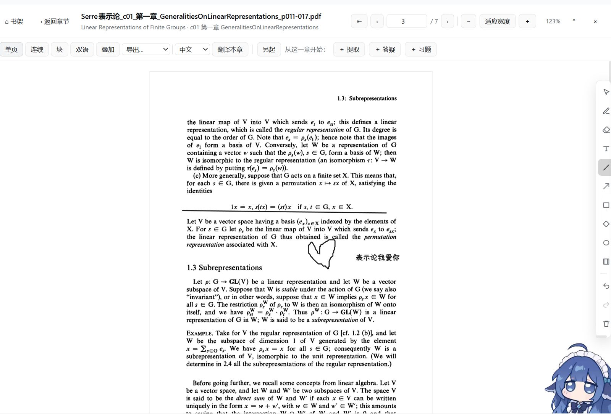
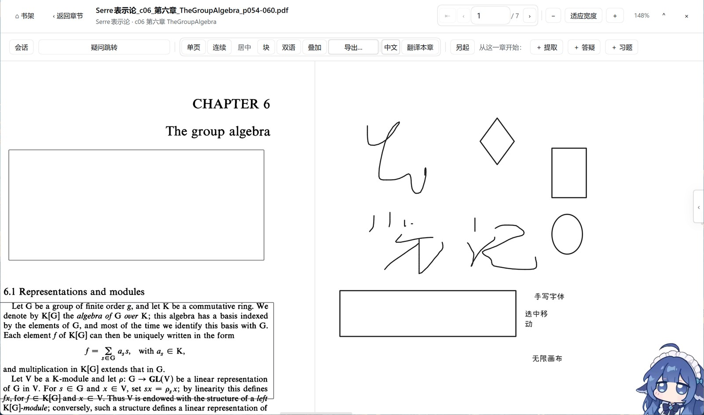
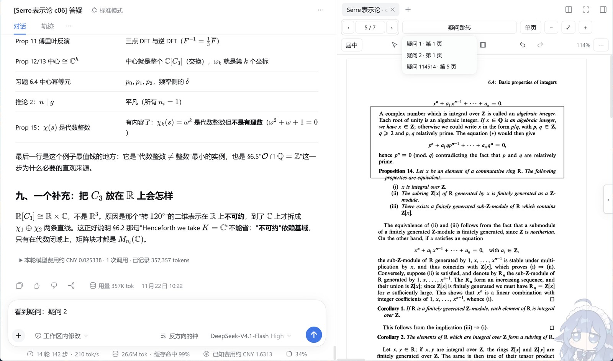
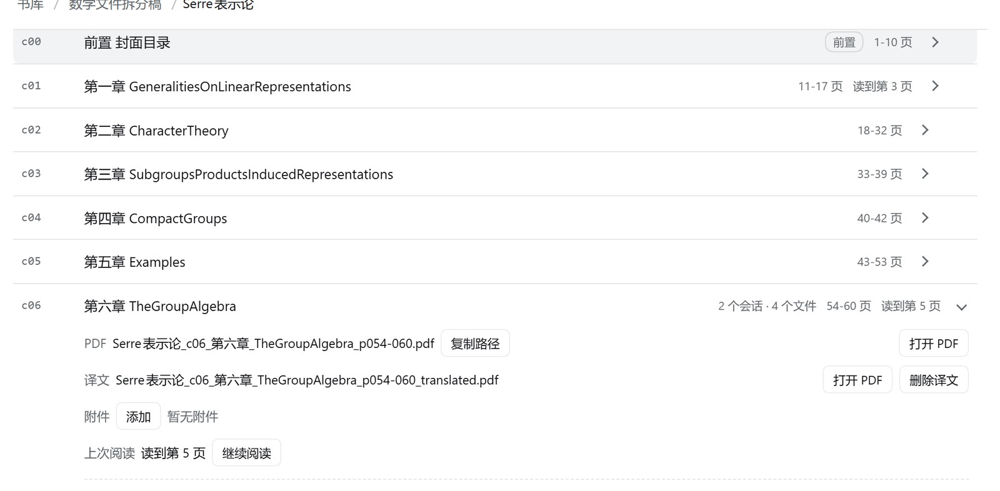
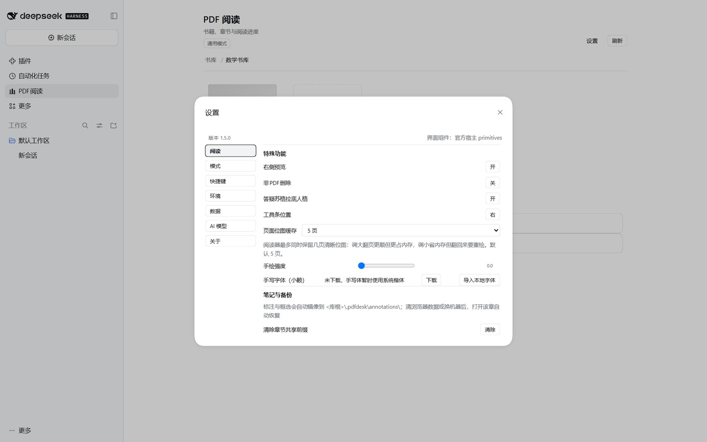
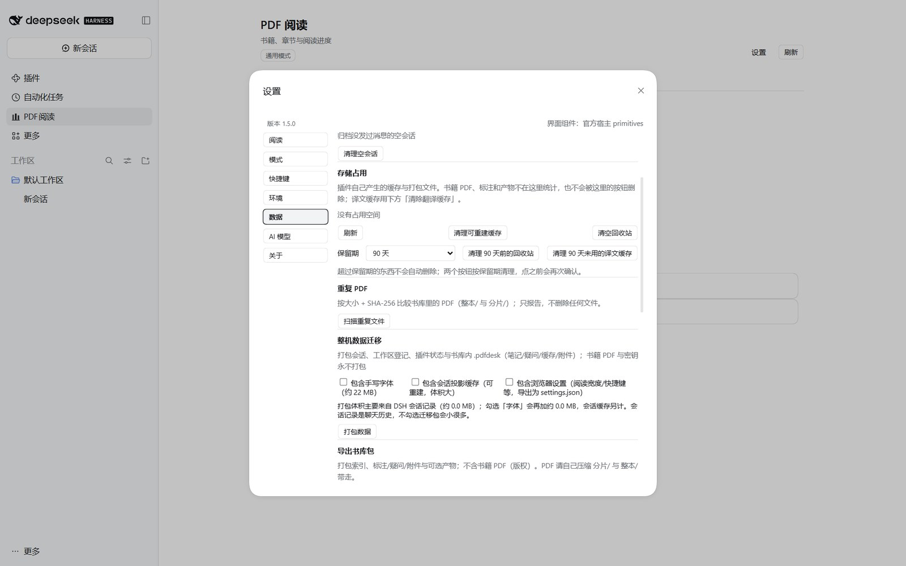
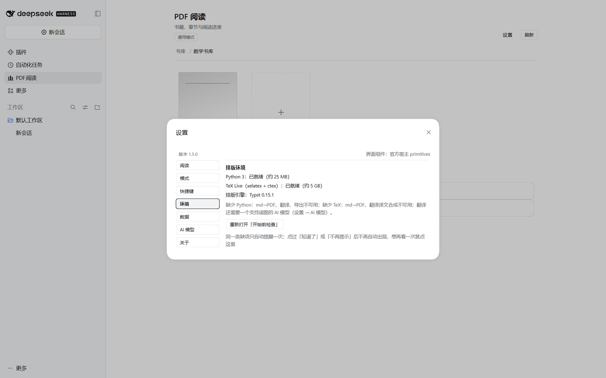

# PDF 阅读 · 随时问答

> DSH 插件 **dsh-pdf-workbench**：把一本 PDF 读成一张可批注、可提问、可回看的整页工作台。

[](https://github.com/minggemofashi/dsh-pdf-workbench/releases)
[](./LICENSE)
[](#平台与系统)
[](https://github.com/topics/dsh-plugin)

<p align="center"></p>

普通 PDF 阅读器只负责“看”。真正读一本书时，你还要在阅读器、笔记、聊天窗口和文件管理器之间来回切换：这一章讲到哪里了？上次的标注还在吗？想摘一段、问一句，还得复制书名、章名和页码；译文和原文对不上时，只能框一段看一段。

**PDF 阅读 · 随时问答** 把“书 → 章”做成骨架，把阅读、标注、双语、问答和产物放进同一个整页工作台。界面跟随 DSH 主题：颜色、描边和阴影使用 `--dsw-*` token，深色模式无需另装皮肤。

## 它适合谁

- **读数学书、教材、讲义的人**：按章拆 PDF，每章独立会话、独立标注；公式、定理和习题都能就地提问。
- **需要边读边写的人**：手写、文本、形状、框选和疑问标记都在同一张页面上，缩放、翻页、换机器都不跑位。
- **想读原文又需要译文的人**：整章翻译后左右并排；框选覆盖层在原文页上直接显示译文。
- **不想把整本书塞进模型的人**：书库、书架、阅读、标注和普通预览都不进上下文；只有你主动新建会话时，才发送当前章的必要信息。

## 功能状态（2026-11-27）

> 这一节随版本更新，如实标注。

- **日常常用**（书库、书架、单页/连续阅读、手写/文本/形状/疑问、章节会话、附件、设置）：作者本人每天在用，没有发现阻断性 bug；交互手感仍在打磨。
- **双语对照**：稳定，可日常使用。
- **覆盖层（在原文页上框选区显示译文）**：**可用**。v1.5 起改成按 `layout.json` 排版的浏览器文本层 + KaTeX 公式，不再是等比位图：任意缩放清晰，框与字同源；排版走 Typst，**不再依赖 TeX Live**。
- **数据打包与导入**：同机打包（迁移包 / 书库包 / PDF 包）、导入向导、`.lnk` 按目标导入都已实测（2026-11-26）。**换一台新机器的端到端恢复尚未实测**，重要数据仍请另存一份。
- **排版引擎**：默认 Typst（可一键下载，单个可执行文件）；没有时回退 TeX Live 的 xelatex，也可用 `MATH_DESK_ENGINE=latex` 强制回退。

## 快速开始

1. DSH → **Plugins → Add plugin**，选插件目录或市场条目，重启 DSH（客户端不热更新）。
2. 打开侧栏「PDF 阅读」→「添加书库」，选一个库根目录；库根里至少有 `分片` 或 `整本` 之一。
3. 进书架双击书，展开章节，打开 PDF 或新建「提取 / 答疑 / 习题」会话。

书库没有现成的书时，书库页的「载入示例书」会装一本 10 章的《中国剩余定理》示例，用来熟悉书架、阅读器与拆分面板。

### 书库目录约定

```
<库根>/
  分片/<书 id>/         一章一个 PDF，文件名带页码范围（如 概率论_积分和数学期望_97-138.pdf）
  整本/                 整本书 PDF，作为“只有一章的一本书”阅读
  产物/<书 id>/<章号>/  该章生成的笔记与文档（白名单内的文本类文件可在右侧预览）
  封面/                 自定义封面
  索引.json             书名/章名等元数据（可选，插件会维护）
  .pdfdesk/             标注镜像、疑问、附件清单、译文缓存（插件写，别手改）
```

> 按章拆分推荐用任意 PDF 工具手动完成，或用插件自带的「按页拆分整本 PDF」：缩略图每行 4 页，页间竖向虚线 + 剪刀，范围与输出文件名实时预览，拆分方案按书记住。

## 核心能力

| 模块 | 能力 |
| --- | --- |
| 书库 | 多个书库；`分片/<书 id>/` 一章一个 PDF，或 `整本/` 放整本书；单击切换、双击进入书架 |
| 书架 | 封面、作者、章节数；单击选中、双击进书、空白拖拽框选；书架分组、隐藏书籍、回收站 |
| 章节 | 提取 / 答疑 / 习题三种会话；导入已有会话、重命名、取消挂载；产物按章归档 |
| 阅读器 | 内置 pdf.js；单页 / 连续、适应宽度、缩放、页码跳转、键盘翻页；右侧可开同章预览 |
| 画布 | 页面 + 页外可写区域；手写、文本、形状、框选、疑问标记；笔压、手绘风格、撤销 / 重做 |
| 选择 | 单击选中、拖拽移动；选择工具支持框选多个元素；Backspace / Delete 删除；形状四角缩放 |
| 双语 | 整章翻译后左右并排；原文栏与译文栏各自保存标注 |
| 覆盖层 | 在原文页上框选区域，只显示框内译文；文本层 + KaTeX 排版，Typst 引擎，缩放清晰；结果保存在本章 sidecar |
| 问答 | 会话自带书名 / 章名 / PDF / 阅读位置 / 产物目录；支持苏格拉底式答疑人格；日常 / 高质两种思考模式 |
| 附件 | 章节详情内添加 PDF / 图片；PPT 可自动转 PDF（需本机 Office 或 LibreOffice） |
| 数据 | 三种包：整机迁移包、书库包、PDF 包；后台打包 + 打包记录（下载 / 打开位置 / 删除）；存储占用、保留期清理、重复 PDF 报告 |
| 导入 | 一个管线收口全部导入：PDF / md / txt、书籍包 ZIP、迁移包 ZIP；校验文件头（假 PDF、改名快捷方式、0 字节都拒）、同内容去重、统一 `-2` 命名、原子落盘、统一报告；导入向导按书勾选；Windows 快捷方式按目标 PDF 导入 |
| 拆分 | 按页拆分整本 PDF：书库页 / 书本页 / 设置三处入口；缩略图每行 4 页，页间竖向虚线 + 剪刀；拆分方案按书记住 |
| 设置 | 阅读、模式、快捷键、环境、数据、AI 模型、关于；AI 页可选每个环节的模型与思考模式（日常 / 高质）；可选手写字体下载 / 导入 / 删除 |

## 阅读与画布

<p align="center"></p>

- **单页 / 连续**：单页一次专注一页，连续沿章节纵向滚动；模式全局记忆，所有书一致。
- **共享画布**：单页和连续共用同一层页面注释，页外坐标允许越出 `0..1`；切换视图不丢笔记。
- **页外边界**：画布有边界，四条边各有一个「+」方块，每按一次向外扩一页；边界在单页是不参与滚动的覆盖层，不会凭空多出空白。
- **工具**：手、选择、笔、橡皮、文本、疑问、直线、箭头、矩形、菱形、椭圆、框选；工具条在页面边缘竖排，不额外占阅读区。
- **框的手感**：框用页内固定色 + 白描边，深色主题下也不会在白底页面上消失；可在已有框（含框体内部）直接拖出新框；选中的文本框顶部有四向握把，四角可缩放。
- **选择与删除**：选择工具可框选多个元素，拖动实时移动，Backspace / Delete 删除；一次撤销可整体还原。
- **页外笔记**：页外只画笔记，不渲染相邻页 PDF；连续模式同样可以在页面外侧起笔。
- **快捷键**：`←/→` 或 `PageUp/PageDown` 翻页，`Home/End` 首末页，`Ctrl +=/-` 缩放，`F` 适应宽度，`T` 切换单页/连续，`G` 跳页，`H` 或按住空格临时切手，`P/E/X` 笔/橡皮/文本，`Q` 疑问框，`Shift+Q` 疑问跳转，`Esc` 关闭阅读器。设置 → 快捷键可改。

<p align="center"></p>

## 章节会话、思考模式与风格提示词

每章的三类会话是“提取 / 答疑 / 习题”。第一次打开某章时，Host 会把该章 `text.md` 读一次，生成一个**隐藏的基础会话**并归档；之后每种模式从这段前缀 fork 出自己的分支。效果是：

- 同一章的多个模式不必反复读同一份章节文本；
- 基础会话不出现在侧栏，也不会混进你的对话列表；
- 分支之间上下文互不污染；扫描件无法提取文本时，自动回退为普通会话。

会话标题形如 `[书 id c04] 答疑`；会话自带书名、章名、PDF、产物目录和阅读位置，不需要每次重新解释“我在读哪本书”。

<p align="center"></p>

<p align="center"></p>

设置 → AI 模型 顶部是**思考模式**：两种模式都读整章，区别在回答风格——「日常」先给结论、3–5 句说清（像网页端聊天），「高质」允许长篇推导与证明。切换只影响之后新建的会话；思考深度本身由你在 DSH 里选的模型决定，插件不覆盖。

同一页还有**风格提示词（可改）**：日常 / 高质各一句写进新会话开头的风格要求，可以按自己的习惯改写；清空后点「恢复默认」回到出厂措辞。

<p align="center"></p>

## 双语与覆盖层

<p align="center"></p>

- 整章翻译后可以左右并排；两栏共享页码与翻页，但各有自己的标注层。
- 也可以在原文页上框出区域，只让框内露出译文；框选结果保存在本章 sidecar 中，可导出 / 导入。
- 覆盖层是浏览器文本层（DOM 文本 + KaTeX 公式），按 `layout.json` 绝对定位，和页面同源：缩放不糊、框与字对得上。
- 翻译按页缓存，支持断点续译；需要本机 **Python 3** 与 **DeepSeek API Key**。

<p align="center"></p>

## 附件、产物与打印

- **附件**：章节详情里添加 PDF / 图片，点击可在阅读器中打开；重名、删除、目录内手工文件都有处理。
- **PPT → PDF**：优先本机 PowerPoint COM，失败再尝试 LibreOffice；没有转换器时给出明确提示，不卡住。
- **产物**：`产物/<书 id>/<章号>/` 下的文本类文件可在右侧预览；Markdown 可以一键生成打印页，用浏览器打印，不落临时 PDF。
- **Office 文件**：DOCX/DOC 不强行在插件内渲染；点击时通过 DSH 官方文档预览打开（需要该章至少有一个会话提供文件地址），失败会提示用 Office 打开。

<p align="center"></p>

## 导入、导出与迁移

- **一个导入管线**：书库「导入文件」、封面末尾「+」、书籍包、迁移包全部走同一个 Host 管线：校验文件头（假 PDF、改名快捷方式、0 字节、非 UTF-8 文本都拒）、流式写临时文件后原子落盘、同内容（size + sha256）判重不写第二份、重名统一 `-2, -3…`，一次导入返回统一报告（新增 / 重复跳过 / 改名 / 拒绝及原因）。
- **导入向导**：书库「+」与 设置 → 数据 共用同一面板——① PDF 包（ZIP；子目录=拆分书，散装 PDF=整本书）② 笔记包（书库包或整机迁移包）③ 逐本勾选要导入的书；书库已有相同 PDF 的书自动勾选并置灰，PDF 不重复导入，笔记按每本选择合并 / 覆盖 / 跳过。
- **Windows 快捷方式**：上传 `.lnk` 会解析它指向的 PDF 并导入**目标文件**，快捷方式本身永不进书库；网络路径、目标丢失、目标不是 PDF 都会明确拒绝。
- **三种包**（设置 → 数据）：整机迁移包（会话 + 工作区登记 + 插件状态 + 各书库 `.pdfdesk`，**不含 PDF**）、书库包（`索引.json` + 标注/疑问/附件 + 可选产物，**不含 PDF**）、PDF 包（只含 `分片/`、`整本/` 里的 PDF）。
- **打包记录**：列出本机生成过的包（类型 / 时间 / 大小 / 书库名），可下载、📂 打开位置、🗑 删除；文件被移走或删除后记录自动消失。打包在 Host 后台进行，不再被长请求掐断。
- **导入策略**：迁移包先校验 manifest 的逐文件 sha256；`merge` 永不覆盖（同名改 `*.imported-<时间>`）、`overwrite` 先做 `pre-import-*` 快照（保留 3 份）、`skip` 跳过同名。只重写 `libraries.json` 的旧库根前缀；会话与工作区路径只报告、不擅自改。
- **包体积**：迁移包的大头是 DSH 会话记录（本机约 122 MB，单个会话可达 36 MB）；勾选「字体」约 +21 MB。设置 → 数据 会直接显示这些数字。
- **流式**：书籍包 / 笔记包读中央目录后逐条流式解压落盘（边写边算 sha256 与 CRC），迁移包打包与导入同样流式；GB 级包不会把 Host 进程内存顶满，损坏包在写盘前就被拒绝。

## 数据与隐私

- **书库目录**与**插件数据目录**在 设置 → 数据 → 「数据位置」只读显示（由 profile 配置决定，不能在设置里改）。
- 书库里的 `分片` / `整本` 放 PDF；`产物` / `封面` / `.pdfdesk` / `回收站` / `工具` / `索引.json` 是插件数据。目录名不要手动改，改了会破坏书库与索引。
- 标注镜像在书库内 `.pdfdesk/annotations/`；疑问、附件清单、译文缓存在 `.pdfdesk/` 下。译文缓存随书库走（`<书库>/.pdfdesk/translation/<书 id>/<章>/`），两个书库的同名书不会串。
- 会话由 DSH 保存在本机；不收集遥测、不需要账号、不上传书库。
- **问答、整章翻译、覆盖层**会调用你在 DSH 里配置的模型 API；发送的是会话上下文和必要的页面文本 / 页图，是否发送由你发起。
- 迁移包不包含书籍 PDF、API Key 或凭据。

## 设置

设置页分左侧页签：**阅读 / 模式 / 快捷键 / 环境 / 数据 / AI 模型 / 关于**。

- **阅读**：页宽、右侧预览开关、手绘强度、笔压测试、手写字体（下载 / 导入 / 删除）、页面位图缓存页数（2/3/5/8，默认 5，改完立即生效）；
- **模式**：数学模式开关（提取 / 答疑 / 习题与数学提示词）；
- **快捷键**：录制、清除；
- **环境**：Python、Typst / TeX、API Key 状态与安装入口，「开始前检查」可重新打开；
- **数据**：数据位置（只读）、存储占用与保留期清理、重复 PDF 报告、三种导出包与打包记录、导入向导与迁移包导入、清除译文缓存；
- **AI 模型**：思考模式（日常 / 高质）、可编辑风格提示词、翻译 / 会话 / 其它三个环节的模型、自检；
- **关于**：版本、GitHub、反馈入口（预填版本与系统信息，不含本机路径）。

<p align="center"></p>

<p align="center"></p>

## 环境要求

- **平台**：Windows 10 / 11（x64）优先适配；macOS / Linux 未适配、未测试。
- **DSH**：插件版本要求见 `package.json` 的 `engines.dsh`。
- **Python 3**：整章翻译、扫描件文本提取。
- **Typst（推荐，也是默认排版引擎）**：单个可执行文件。设置 → 环境 →「排版引擎」可一键下载（校验后装到 `%LOCALAPPDATA%\dsh-pdf-workbench\typst\`）；也可放在插件 `tools\typst\`、PATH，或设 `MATH_DESK_TYPST` 指向它。
- **TeX Live（可选）**：没有 Typst 时的回退（xelatex + ctex），或用 `MATH_DESK_ENGINE=latex` 强制；装了 Typst 就**不需要** TeX。
- **本机 PowerPoint 或 LibreOffice**：PPT → PDF（可选）。
- **手写字体**：可在线下载（约 22 MB）或导入本地字体，不装时回退系统楷体。

> 排版能力不再依赖 TeX：覆盖层与读版 PDF 都走 Typst，同一章约 10 s，比 LaTeX 路径快约 9 倍。

<p align="center"></p>

## 安装、更新与卸载

### 插件市场 / DSH 插件页（推荐）

DSH → **Plugins → Add plugin** → 选择市场条目或插件目录 → 重启 DSH。

### npm

```bash
dsh plugin add dsh-pdf-workbench
```

### 本地目录（开发）

DSH → **Plugins → Add plugin** → 选择本仓库目录 → 重启 DSH。客户端改动不会热更新，需要重启。

### 更新

在插件市场点更新，或重新执行 `dsh plugin add dsh-pdf-workbench`，然后重启 DSH。书库、标注、译文缓存与设置都在插件目录之外，更新不会丢数据。

### 卸载

DSH 侧栏插件管理里移除 `dsh-pdf-workbench` 并重启。**不会**自动删除书库与 `~/.dsh/pdfdesk/` 下的插件数据；确认不需要后再手动删除对应目录。

## 常见问题

**现在适合日常使用吗？**  
常用功能（书架、阅读、标注、章节会话、附件）作者本人每天在用，没有阻断性 bug；交互手感仍在打磨。

**双语和覆盖层能放心用吗？**  
都能用。双语对照稳定；覆盖层在 v1.5 改成文本层 + KaTeX + Typst 排版，缩放清晰、框与字同源，且不再需要 TeX Live。

**迁移包能当唯一备份吗？**  
同机打包与导入已实测；换新机器尚未做端到端恢复验证。迁移包**不含书籍 PDF**，换机器时记得把 `分片/`、`整本/` 一起带走，重要数据另存一份。

**支持扫描版 PDF 吗？**  
支持打开、翻页、缩放、手写 / 形状标注和框选。插件本身不做 OCR；文本选择、整章翻译和问答质量取决于所选模型能否直接读页面图像。

**可以自动拆书吗？**  
不自动识别章节。插件提供按页拆分工具（每行 4 页缩略图 + 竖向虚线剪刀）和命名规则，推荐按目录手动拆成“一章一个 PDF”。

**为什么整本书会话很贵？**  
整本书会一次性进入上下文；只适合小文件或论文。按章拆分的成本和定位都更好。

**手写字体下载失败？**  
字体源是上游 OFL 发布资产；网络不可达时可在设置里用「导入本地字体」，删除后回退系统楷体。

**翻译按钮没反应？**  
检查设置 → 环境里的 Python 与 DeepSeek API Key；缺环境时按钮会弹出说明和安装入口。

**没有 Typst 能用吗？**  
能。没有 Typst 时回退 TeX Live 的 xelatex；两者都没有时会明确提示，不会静默失败。

**会同步到云端吗？**  
不会。不收集遥测，不需要账号，书库与会话都在本机。

**macOS / Linux 能用吗？**  
未适配、未测试；路径分隔符、Python / TeX 检测都按 Windows 编写。

## 开发

- 设计、数据布局、模块边界：[`docs/`](docs/)
- 版本变化：[`CHANGELOG.md`](CHANGELOG.md)
- 安装与分发：[`安装与分发.md`](安装与分发.md)
- 页面截图：`assets/screenshot-*.jpg`（1600px 宽、浅色主题、无本机路径），展示顺序见 [`screenshots.json`](screenshots.json)

## 许可与致谢

- 插件代码：MIT
- [pdf.js](https://mozilla.github.io/pdf.js/)：Apache-2.0
- [KaTeX](https://katex.org/)：MIT（覆盖层文本层的公式渲染）
- [Typst](https://typst.app/)：Apache-2.0（默认排版引擎，按需下载，不随包分发）
- [rough.js](https://roughjs.com/)：MIT（手绘形状）
- [Excalifont](https://github.com/excalidraw/excalidraw)：SIL OFL 1.1（拉丁手写）
- [Xiaolai（小赖字体）](https://github.com/lxgw/kose-font)：SIL OFL 1.1（中文手写）

字体与第三方许可文件随包放在 `vendor/` 下。
