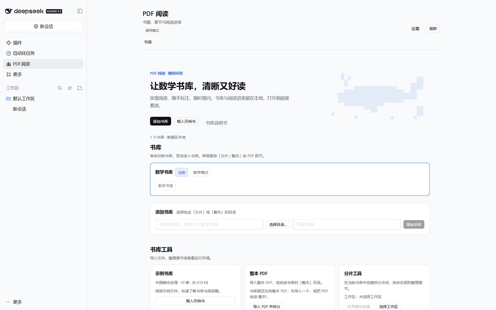
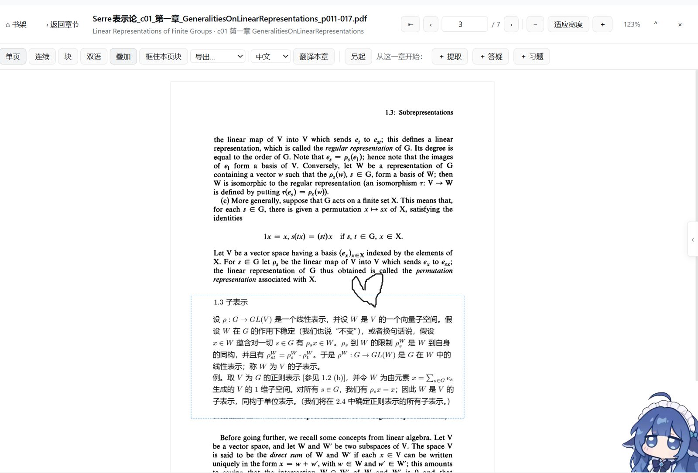

# PDF 阅读 · 随时问答

> DSH 插件 **dsh-pdf-workbench** · 把一本书，读成一个工作台。

[](https://github.com/minggemofashi/dsh-pdf-workbench/releases)
[](./LICENSE)
[](#平台说明)
[](https://github.com/topics/dsh-plugin)

按章阅读、随手标注、随时提问。书库和进度都在本地，打开就能接着读；需要时再让模型陪你把一章读透。

<p align="center"></p>

## 它解决什么问题

普通 PDF 阅读器只负责“看”。真正读一本书时，你还得在阅读器、笔记、聊天窗口和文件管理器之间来回切换：

- 这一章讲到哪里了？上次的标注还在吗？
- 想摘一段、问一句，还得复制书名、章名、页码；
- 译文和原文对不上，框选一段才能看；
- 习题、笔记、导出的 PDF 散落在不同文件夹。

**PDF 阅读 · 随时问答** 把“书 → 章”做成骨架，把阅读、标注、双语、问答和产物放进同一个整页工作台。

界面跟随 DSH 主题：颜色、描边和阴影走 `--dsw-*` token，深色模式不需要另装皮肤。

## 适用于哪些书

**任何类型的书都能读，但“模式”目前只做了数学。**

- 阅读器、书库、书架、标注、双语、右栏预览和问答对任何 PDF 都可用：教材、讲义、论文、闲书都能放进来读、画、问。
- 当前最完整的是**数学工作流**：按章拆分、提取 / 答疑 / 习题模板、公式与 LaTeX、产物转 PDF；这些提示词和模板都是围绕数学课本调的。
- 其它学科现在能读、能问，但还不算“适配好的模式”；后面会按学科 / 工作流继续做（人文、语言、计算机等），目标始终是**边学边问**，而不是只做一个翻页器。
- **扫描版也支持**：数学课本扫描件正是做这个插件的主要原因之一。打开、翻页、缩放、手写 / 形状标注、框选都没问题；但插件本身提取不了扫描件的文字，**文本选择、整章翻译和问答本质上依赖你选择的模型能不能直接读页面图像**。模型能读图就可以直接问；不能读图就先 OCR，或换成带文字层的版本。

## 模式

- **通用**是默认基础，始终加载、不能被选择：书库、阅读、标注、双语、翻译和通用工具都在这里。
- **数学**是可选的唯一工作流，在 **设置 → 模式** 开启。开启后显示提取 / 答疑 / 习题三种会话、数学提示词和 LaTeX 工作流；关闭后三种数学类型隐藏，**会话面板保留**并仍可管理通用「会话」，数据保留，重新开启即可回来。**再次点击「数学」卡片即可退出到通用**；以后有多个模式时，点另一个会直接切换。
- PDF 页工具条上的 **「会话」按钮是通用功能**：新建一个只携带书籍地址、不预设用途的普通会话，并归档到该章的会话面板（类型「会话」）；任何模式下都能用。
- 同一时间只能启用一个模式；以后增加其它工作流时沿用同一套单选结构。翻译属于通用功能，不依赖数学模式。

## 更新

设置 → 关于 → **检查更新**。发现新版本后会显示「立即更新」：

- dshmarket 的更新 API v1 管理本插件时，走市场的一键更新并显示进度；
- 未由市场管理时，按钮直接下载新版本 zip，解压后在 DSH 插件页更新。

## 第一次使用

首次启动**不会自动生成书库**。打开插件会直接进入书库页：

- 添加自己的书库根目录（包含 `分片` 或 `整本`）后才会扫描；
- 示例书库也只在已有书库后才会显示加载入口；
- 删除最后一个书库后保持空状态，不会变回一个默认书库。

## 工作区

新建会话需要工作区来存放对话。插件**不会自动创建工作区，也不会把会话写进临时目录**：

- 书库目录已有对应工作区时直接使用；
- 没有时弹出说明，让你选择已有工作区，或为书库目录新建一个；
- 选择结果会按书库记住，重载或切换书库后继续使用；
- 工作区只保存对话，不会移动、复制或删除书库文件；
- 取消则不会创建任何会话。

打开一个**空白会话**时，如果输入框是空的（例如之前把提示词删了），工作台会把书籍地址和该模式的引导重新放回去；输入框已有内容时不会追加，避免重复注入。

## 看一眼

### 1. 书库：多个库，一个入口

<p align="center"></p>

书库根里按「分片 / 整本」放 PDF 即可。书架按书展示封面、章节数，双击进书；也支持书架分组、隐藏书籍和回收站。

### 2. 阅读器：标注跟着页走

<p align="center"></p>

内置 pdf.js，单页 / 连续、适应宽度、缩放、键盘翻页。笔、橡皮、文本框、框选、直线 / 箭头 / 矩形 / 菱形 / 椭圆都在页面边缘的竖排工具条里；标注归一化保存，缩放、换页、换机器都不跑位。

- **选择工具**：点中笔画 / 文本 / 形状后拖动移动，形状四角拖动缩放；属性面板改颜色、粗细、填充、线型、不透明度，支持复制、置顶 / 置底、删除。
- **手写风格**：内置 rough.js，形状可以画成 Excalidraw 那种抖动/双线；设置里可调手绘强度（0 = 干净几何）。
- **笔压**：支持触控笔压力变化；鼠标按 0.5 处理。
- **撤销 / 重做**：按页记录，翻页不丢。

### 3. 双语：原文和译文并排，框选露译文

<p align="center"></p>

整章翻译后可以左右并排；也可以在原页上框出区域，只让框里露出译文。两栏共用页码与翻页；原文栏标注跟随原页，译文栏有自己独立的标注层。

<p align="center"></p>

### 4. 随时问答：书名、章名、PDF、页码都在上下文里

<p align="center"></p>

从章节直接打开「提取 / 答疑 / 习题」，会话的第一条消息就带着书名、章名、PDF、阅读位置和绝对路径，不用每次重新解释“我在读哪本书”。右侧预览仍是同一个阅读器，可以继续翻页、标注，页码与主视图同步。

可选**苏格拉底式答疑人格**：默认先反问、只问一两个关键问题、不直接给完整推导；在「设置 → 阅读」里可以关闭，或直接编辑本地人格文件。人格只影响答疑会话，不改变其他模式。

## 功能一览

| 模块 | 能力 |
| --- | --- |
| 书库 | 多书库、单击切换、双击进书架、移除；分片 / 整本两种模式 |
| 书架 | 封面、章节数、书架分组、隐藏、拖拽框选、回收站 |
| 章节 | 提取 / 答疑 / 习题三种会话，导入已有会话、重命名、整理提纲 |
| 阅读器 | pdf.js、单页 / 连续、适应宽度、缩放、页码、键盘操作 |
| 标注 | 笔 / 橡皮 / 文本 / 框选；直线、箭头、矩形、菱形、椭圆；选择、移动、缩放、填充、线型、透明度、复制、层级；撤销 / 重做；笔压；手绘风格 |
| 双语 | 整章翻译、双栏并排、译文覆盖框选、导出 |
| 右栏预览 | 同一阅读器、跟随栏宽、页码 / 模式同步、可在右栏直接标注与框选 |
| 问答 | 会话自带书名 / 章名 / PDF / 页码 / 路径；答疑人格可选；提取与习题模式 |
| 产物 | 行内预览、Markdown 转 PDF（可选）、产物会话、回收站 |
| 设置 | 右侧预览、非 PDF 删除保护、工具条位置、手绘强度、快捷键、环境、GitHub 入口 |

## 和普通 PDF 阅读器的区别

- **不是“打开一个文件”，而是“进入一章”**：会话、标注、译文、产物都挂在书/章上。
- **标注是数据，不是截图**：按页保存、可撤销、可复制、可改样式，并与库里的 `.pdfdesk\annotations\` 镜像同步。
- **双栏和覆盖都是同一页**：不是两个阅读器拼在一起，页码与翻页共享；原文栏与译文栏各有自己的标注层。
- **问答不用手动补上下文**：书名、章名、PDF、页码、路径随会话第一条消息一起发出。
- **本地优先**：书库、标注、会话记录都在本地；问答与翻译只走你配置的模型。

## 安装

### 从 GitHub Release（推荐）

1. 打开 [Releases](https://github.com/minggemofashi/dsh-pdf-workbench/releases)，下载最新的 `dsh-pdf-workbench-<版本>.zip`；
2. 解压到任意目录（不要在压缩包里直接运行）；
3. DSH → **Plugins → Add plugin** → 选择解压后的插件目录；
4. 重启 DSH（Host 路由与侧栏图标在启动时注册）。

> 截图对应当前版本。

### npm（推荐给市场与一键更新）

```bash
dsh plugin add dsh-pdf-workbench@1.3.1
```

### 本地目录（开发）

DSH → Plugins → Add plugin → 选择本仓库目录，重启 DSH。

### 平台说明

**Windows 10/11 优先适配**。macOS / Linux 未适配、未测试；插件里的路径拼接、Python / TeX 检测都按 Windows 编写。

### 可选依赖

Markdown → PDF 需要本机 **Python 3 + TeX（xelatex、ctex）**；翻译还需要 **DeepSeek API Key**。缺环境时对应的「转 PDF」「翻译」「导出」会弹出说明和下载入口；阅读、会话、预览 md 都不受影响。安装方法见库页的「书库说明书」。

## 数据与隐私

- 书库、标注、会话记录、设置都在本机：书库列表与设置在 `~/.dsh/pdfdesk/`，标注镜像在书库 `.pdfdesk/annotations/`，会话由 DSH 保存在本地。
- 不收集遥测，不需要账号，不把书库上传到任何地方。
- **问答与整章翻译**会调用你在 DSH 里配置的模型 API；发送的内容是会话上下文和必要的页面文本。是否发送由你发起，不使用时不发送。
- 标注镜像用 `.pdfdesk\annotations\` 保存，换浏览器或换机器后打开该章会自动恢复。

## 常见问题

**问：支持扫描版 PDF 吗？**  
答：支持，扫描的数学课本正是做这个插件的主要原因之一：打开、翻页、缩放、手写 / 形状标注、框选都没问题。  
但插件本身提取不了扫描件的文字：**文本选择、整章翻译和问答本质上依赖你选择的模型能不能直接读页面图像**。模型能读图就可以直接问；不能读图就先 OCR，或使用带文字层的版本。

**问：可以自动拆书吗？**  
答：不自动识别章节。插件提供拆分工具和命名规则，按目录手动拆成“一章一个 PDF”最稳。

**问：会同步到云端吗？**  
答：不会。插件没有云同步；需要备份就把书库和 `~/.dsh/pdfdesk/` 一起复制。

**问：从哪里安装？**  
答：三种方式任选：**npm**（`dsh plugin add dsh-pdf-workbench@1.3.1`）、[GitHub Releases](https://github.com/minggemofashi/dsh-pdf-workbench/releases) 的 zip，或等插件市场收录后在 dsh-market 搜索「PDF 阅读」。旧包 `dsh-pdf-math-desk` 已从 npm 删除，请用新包名。

**问：形状能像 Excalidraw 一样多选 / 绑定箭头吗？**  
答：目前没有多选、没有箭头绑定和曲线。现有的是单元素选择、移动、四角缩放、样式、复制和层级。

**问：为什么截图里有中文手写？**  
答：内置了 SIL OFL 的 **Excalifont**（拉丁）和 **Xiaolai**（中文手写），不联网加载。

## 开发

- 详细设计、数据布局、模块边界：见 [`docs/DETAIL.md`](docs/DETAIL.md)
- 版本变化：见 [`CHANGELOG.md`](CHANGELOG.md)
- 安装与分发细节：见 [`安装与分发.md`](安装与分发.md)

## 许可与致谢

- 插件代码：MIT
- [pdf.js](https://mozilla.github.io/pdf.js/)：Apache-2.0
- [rough.js](https://roughjs.com/)：MIT（手绘形状）
- [Excalifont](https://github.com/excalidraw/excalidraw)：SIL OFL 1.1（拉丁手写）
- [Xiaolai（小赖字体）](https://github.com/lxgw/kose-font)：SIL OFL 1.1（中文手写）

字体与第三方许可文件随包放在 `vendor/` 下。
